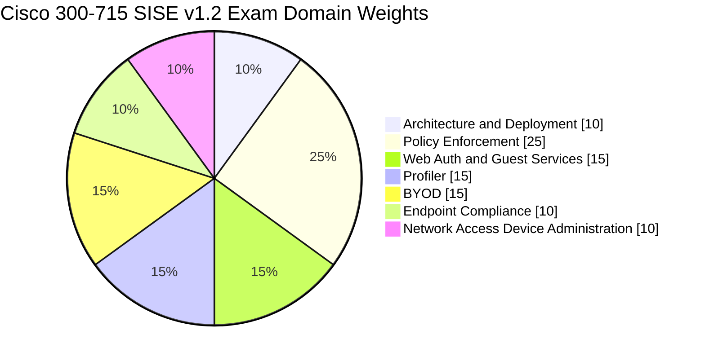
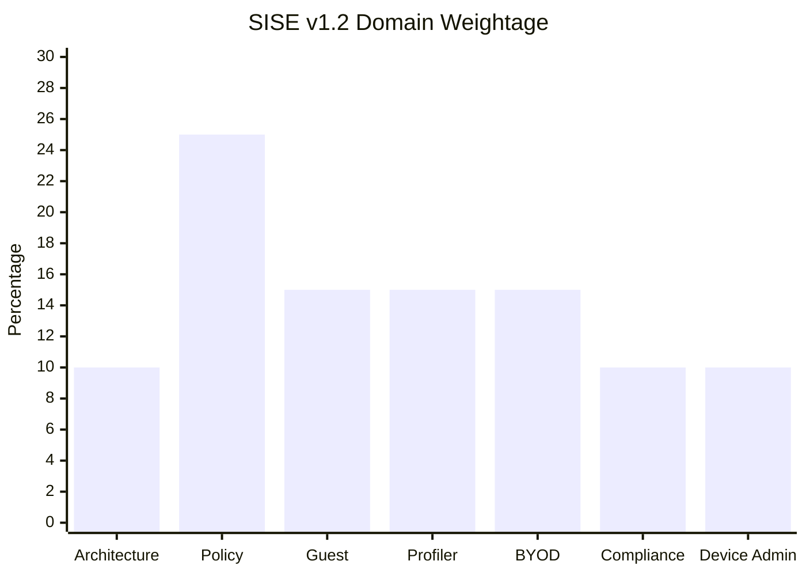
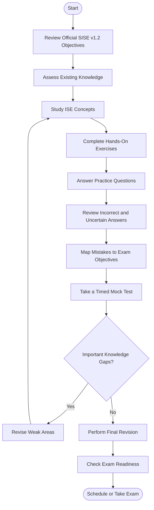
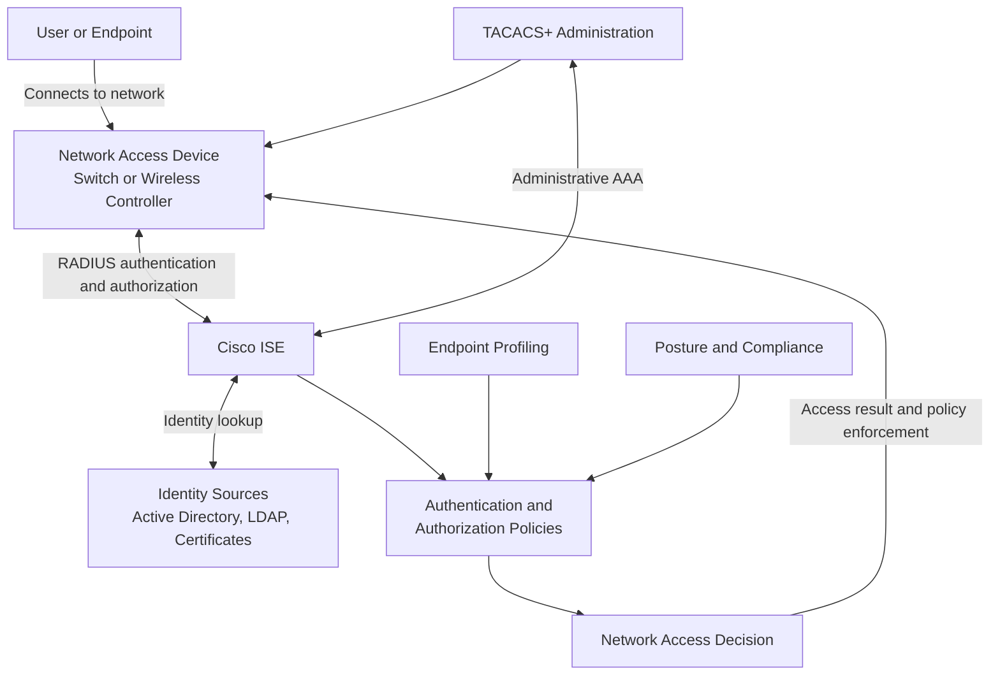
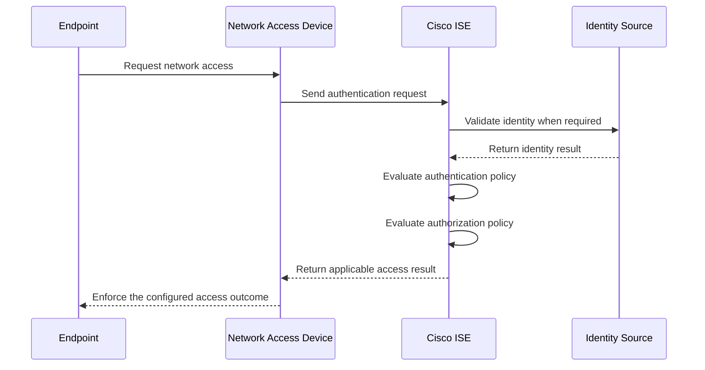
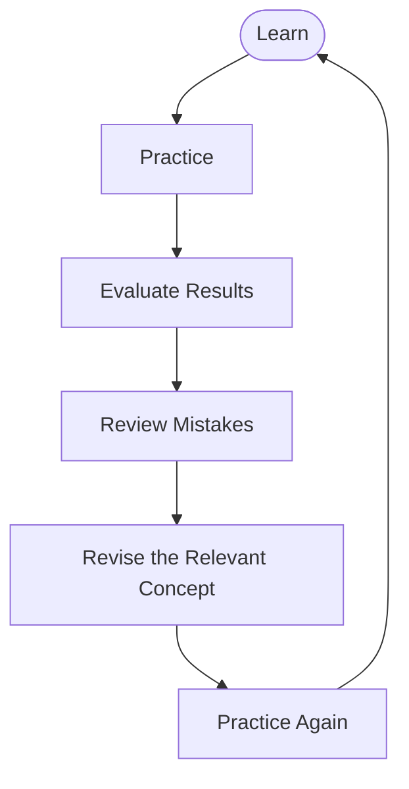
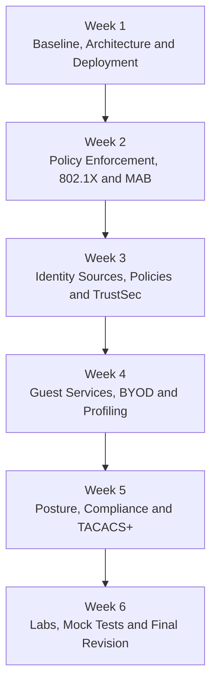

# Cisco 300-715 SISE Study Guide: Implementing and Configuring Cisco Identity Services Engine

A practical, community-oriented study guide for the **Cisco 300-715 SISE (Implementing and Configuring Cisco Identity Services Engine)** certification exam. Learn how Cisco ISE supports identity-based network access control, authentication and authorization, endpoint profiling, guest access, BYOD, posture compliance, and secure network device administration.

This repository combines official exam references, technical explanations, Mermaid diagrams, a structured study roadmap, original practice questions, and suggested hands-on exercises.

> **Exam blueprint:** Cisco 300-715 SISE v1.2  
> **Last reviewed:** October 2026  
> **Official exam information:** [Cisco 300-715 SISE](https://www.cisco.com/site/us/en/learn/training-certifications/exams/sise.html)

---

## Table of Contents

- [Overview](#overview)
- [About the Certification](#about-the-certification)
- [Who Should Prepare?](#who-should-prepare)
- [Exam Information](#exam-information)
- [Official Exam Objectives](#official-exam-objectives)
- [Exam Domain Weightage](#exam-domain-weightage)
- [Certification Preparation Flowchart](#certification-preparation-flowchart)
- [Cisco ISE Technical Architecture](#cisco-ise-technical-architecture)
- [Authentication and Authorization Workflow](#authentication-and-authorization-workflow)
- [Circular Study and Revision Cycle](#circular-study-and-revision-cycle)
- [Step-by-Step Preparation Guide](#step-by-step-preparation-guide)
- [Recommended Study Schedule](#recommended-study-schedule)
- [Practice Questions and Mock Tests](#practice-questions-and-mock-tests)
- [Hands-On Labs and Practical Projects](#hands-on-labs-and-practical-projects)
- [Common Preparation Mistakes](#common-preparation-mistakes)
- [Certification Benefits and Career Relevance](#certification-benefits-and-career-relevance)
- [Frequently Asked Questions](#frequently-asked-questions)
- [Official and Additional Learning Resources](#official-and-additional-learning-resources)
- [About CertsGate](#about-certsgate)

---

## Overview

Cisco Identity Services Engine (ISE) is a network access control and identity-management platform. It helps organizations make network access decisions using information about users, devices, authentication results, and security policies.

The **Cisco 300-715 SISE study guide** is intended to help candidates connect these concepts with practical network security scenarios. Instead of learning each ISE feature in isolation, focus on how identity information becomes an authentication decision, how authorization policies determine access, and how administrators investigate failed sessions.

Key topics include:

- Cisco ISE architecture and deployment.
- Network access devices and RADIUS-based authentication.
- Wired and wireless 802.1X access.
- MAC Authentication Bypass (MAB).
- Authentication and authorization policy design.
- Web authentication and guest services.
- Endpoint profiling and classification.
- Bring Your Own Device (BYOD) onboarding.
- Endpoint posture and compliance.
- TACACS+ network device administration.
- Cisco TrustSec concepts and administration.

Use this repository alongside Cisco's current exam topics and official learning materials. The goal is to develop an understanding of both the exam blueprint and the operational behavior of Cisco ISE.

## About the Certification

The 300-715 SISE exam is titled **Implementing and Configuring Cisco Identity Services Engine**. Cisco identifies it as a concentration exam associated with the CCNP Security certification.

Passing the exam earns the **Cisco Certified Specialist – Security Identity Management Implementation** certification. It can also satisfy the concentration-exam requirement for CCNP Security when combined with the required core exam.

Cisco's current exam page describes the scope as ISE architecture and deployment, policy enforcement, Web Auth and guest services, profiler, BYOD, endpoint compliance, and network access device administration.

Official references:

- [Cisco SISE exam page](https://www.cisco.com/site/us/en/learn/training-certifications/exams/sise.html)
- [Cisco CCNP Security certification](https://www.cisco.com/site/us/en/learn/training-certifications/certifications/security/ccnp-security/index.html)

## Who Should Prepare?

This exam is particularly relevant to:

- Network security engineers implementing identity-based access control.
- Network administrators responsible for wired and wireless access.
- Security engineers working with authentication and authorization policies.
- Cisco ISE administrators supporting guest access and BYOD.
- IT professionals responsible for endpoint compliance and profiling.
- Engineers managing administrative access to network devices through TACACS+.
- Candidates pursuing the CCNP Security certification path.

Cisco recommends familiarity with the Cisco IOS CLI, Cisco Secure Client, Microsoft Windows, and 802.1X. These are useful foundations for understanding the training material, although Cisco's exam page does not list a formal exam prerequisite.

---

## Exam Information

| Item | Details |
|---|---|
| Exam code | 300-715 SISE |
| Official name | Implementing and Configuring Cisco Identity Services Engine |
| Provider | Cisco |
| Current blueprint used in this guide | SISE v1.2 |
| Duration | 90 minutes |
| Price listed by Cisco | US$300 or Cisco Learning Credits |
| Language listed on the exam page | English |
| Certification earned | Cisco Certified Specialist – Security Identity Management Implementation |
| CCNP Security relevance | Concentration exam |
| Question count | Not specified here because a reliable current official count was not verified |
| Passing score | Not specified here because a fixed current public score was not verified |

Exam policies, pricing, delivery options, and objectives can change. Check Cisco's official page before registering.

---

## Official Exam Objectives

Cisco publishes the SISE exam topics as a blueprint for the technical areas that may appear on the exam. The current v1.2 document is the primary reference for this repository.

### Domain 1: Architecture and Deployment

Study:

- Cisco ISE personas and their roles.
- Supported deployment options.
- Hardware and virtual machine performance specifications.
- Zero-touch provisioning.

Understand how deployment decisions affect scalability, availability, and day-to-day administration.

### Domain 2: Policy Enforcement

Study:

- Active Directory and LDAP integration.
- Identity-store options, including PKI, multifactor authentication, and local identity sources.
- Wired and wireless 802.1X.
- IBNS 2.0 modes and host modes.
- MAC Authentication Bypass (MAB).
- Cisco TrustSec.
- Authentication and authorization policies and profiles.

This domain carries the largest published exam weight. Give it substantial preparation time and practise interpreting policy results rather than simply memorizing terminology.

### Domain 3: Web Auth and Guest Services

Study guest access workflows, including web authentication, guest portal behavior, account lifecycle management, and sponsored access.

Be able to explain the difference between guest access methods and identify which workflow fits a particular access requirement.

### Domain 4: Profiler

Study endpoint profiling, data collection, classification logic, profiler policies, and how endpoint attributes influence policy decisions.

Practise distinguishing an endpoint's observed attributes from the profile and authorization outcome assigned by ISE.

### Domain 5: Bring Your Own Device (BYOD)

Study BYOD onboarding, certificate-related workflows, device registration, and device lifecycle management.

Understand how personal devices are enrolled and how access should be handled when a device is lost, removed, or no longer trusted.

### Domain 6: Endpoint Compliance

Study posture assessment, posture-related policies, client provisioning, compliance results, and remediation.

Focus on how compliance status can affect access decisions and how administrators verify whether a posture policy worked as intended.

### Domain 7: Network Access Device Administration

Study AAA fundamentals and TACACS+ administration of network infrastructure.

Understand how ISE can centralize administrator authentication and authorization, including command-level access controls.

**Official blueprint:** [Download the Cisco 300-715 SISE v1.2 exam topics PDF](https://learningcontent.cisco.com/documents/marketing/exam-topics/300-715-SISE-v1.2.pdf)

The blueprint should take priority over third-party summaries. Review it again shortly before your exam in case Cisco publishes a newer version.

---

## Exam Domain Weightage

The following percentages are taken from Cisco's published **SISE v1.2 exam topics** document. They are official domain weights, not estimates.

### Official domain distribution

### Compare the domain weights

| Domain | Official weight |
|---|---:|
| Architecture and Deployment | 10% |
| Policy Enforcement | 25% |
| Web Auth and Guest Services | 15% |
| Profiler | 15% |
| BYOD | 15% |
| Endpoint Compliance | 10% |
| Network Access Device Administration | 10% |
| **Total** | **100%** |

### How to use the weightage

- Spend the most focused study time on Policy Enforcement.
- Give each 15% domain dedicated theory and practical review.
- Do not skip the three 10% domains; together, they account for 30% of the blueprint.
- Use the weights to plan revision, not as a reason to ignore technical dependencies between domains.

Source: [Cisco SISE v1.2 exam topics](https://learningcontent.cisco.com/documents/marketing/exam-topics/300-715-SISE-v1.2.pdf)

---

## Certification Preparation Flowchart

Use this process to move from the official objectives to measurable readiness. If a practice test exposes a knowledge gap, return to the relevant material and test that topic again.

The diagram represents an independent preparation method, not an official Cisco examination process.

## Cisco ISE Technical Architecture

Cisco ISE connects identity information, network access devices, policy evaluation, and enforcement. The following diagram is a simplified conceptual example to help explain those relationships. It is not a prescribed deployment design.

### Understanding the components

| Component | Purpose |
|---|---|
| Network access device (NAD) | Connects endpoints and participates in network access enforcement. |
| Cisco ISE | Evaluates identity and policy information to support access decisions. |
| Identity sources | Provide user or device identity information for supported authentication workflows. |
| Authentication policy | Determines how an authentication request is processed. |
| Authorization policy | Matches conditions and assigns an appropriate access result. |
| Profiler | Uses observed endpoint information to classify devices. |
| Posture services | Assess endpoint compliance where the relevant posture workflow is configured. |
| TACACS+ | Supports centralized authentication and authorization for network device administrators. |

The actual behavior depends on the ISE release, network device capabilities, configured protocols, and policy design. Always consult the relevant Cisco documentation for implementation details.

---

## Authentication and Authorization Workflow

Authentication and authorization are related but different decisions. Authentication determines whether an identity can be verified. Authorization determines what access is granted after the applicable policy conditions are evaluated.

Use this sequence to practise explaining where a failure occurs. An authentication failure, an authorization mismatch, and a network-device enforcement issue can produce similar user symptoms but require different troubleshooting steps.

---

## Circular Study and Revision Cycle

Certification preparation works best as a repeating process. Reading a topic once does not prove that you can apply it to an unfamiliar scenario.

For each cycle:

1. **Learn:** Study one topic using the official blueprint and reliable technical material.
2. **Practice:** Configure a lab or answer original practice questions.
3. **Evaluate:** Explain why your result is correct or incorrect.
4. **Review mistakes:** Identify the exact concept, configuration, or reasoning step that caused the problem.
5. **Revise:** Return to the relevant documentation or lab notes.
6. **Practice again:** Confirm that you can solve a similar problem without relying on memorized wording.

---

## Step-by-Step Preparation Guide

### Step 1: Establish your baseline

Read the official SISE v1.2 objectives and mark each item as:

- **Comfortable:** You can explain it and apply it.
- **Developing:** You understand the idea but need more practice.
- **Unfamiliar:** You need to study it from the beginning.

This gives you a personal study checklist and helps avoid spending all your time on topics you already know.

### Step 2: Learn ISE architecture and deployment

Start with ISE's purpose, node personas, deployment options, installation considerations, and sizing requirements.

Be ready to explain why deployment design matters and how the roles of ISE components relate to the broader access-control workflow.

### Step 3: Master policy enforcement

Study authentication, authorization, identity stores, 802.1X, MAB, and TrustSec. Pay particular attention to the relationship between identity information, policy conditions, and the resulting access decision.

For troubleshooting exercises, ask:

- Was the endpoint or user identified correctly?
- Did the expected authentication policy match?
- Was the correct identity source used?
- Did the authorization conditions match the session?
- Did the network access device enforce the returned result?

### Step 4: Study guest services and BYOD

Compare guest onboarding with BYOD onboarding. Guest workflows commonly focus on temporary or sponsored access, while BYOD workflows address the controlled enrollment and lifecycle of personal devices.

Practise drawing each workflow and identifying where credentials, certificates, portals, or authorization rules are involved.

### Step 5: Learn profiling and posture

For profiling, understand how ISE gathers endpoint attributes and uses them to classify devices.

For posture, understand how compliance results are evaluated and how policies may affect access. Do not assume that profiling alone proves a device is compliant; they address different questions.

### Step 6: Review network device administration

Study TACACS+ and centralized administrative access. Be able to explain how authentication, authorization, and command permissions support administrative control.

### Step 7: Practise troubleshooting

Use logs, reports, session information, and policy results to trace a problem from the initial request to the final decision.

Write down both the root cause and the evidence that supports it. This builds stronger technical reasoning than simply memorizing a fix.

### Step 8: Complete timed practice and final revision

Use original practice questions and mock tests to identify gaps. Revisit weak objectives, then test your understanding again with a different scenario.

A useful readiness signal is being able to explain why an answer is correct, why plausible alternatives are incorrect, and which configuration or evidence supports the conclusion.

---

## Recommended Study Schedule

This six-week plan is an **independent example**, not an official Cisco recommendation. Adjust it according to your existing experience, available lab access, and performance on practice exercises.

| Week | Primary focus | Suggested outcome |
|---|---|---|
| 1 | Architecture, personas, deployment, baseline assessment | A clear map of ISE components and deployment concepts |
| 2 | 802.1X, MAB, identity sources, authentication | Ability to explain common access workflows |
| 3 | Authorization policies, policy evaluation, TrustSec | Ability to trace a policy decision |
| 4 | Guest access, BYOD, profiling | Clear understanding of onboarding and endpoint classification |
| 5 | Endpoint compliance, TACACS+, administration | Ability to explain compliance and administrative access controls |
| 6 | Integrated labs, timed practice, mistake review | A documented readiness assessment and final revision list |

If you have less time, preserve coverage of every official domain and prioritize gaps revealed by your baseline assessment. Avoid replacing practical learning with a large volume of questions alone.

---

## Practice Questions and Mock Tests

Practice questions are useful when they test understanding rather than recognition of familiar wording. These **original educational questions** are written for this study guide and are not actual Cisco exam questions.

### Question 1: Authentication and authorization

An endpoint successfully authenticates, but it receives an access result that does not match the organization's intended policy. Which area should be investigated first?

A. The authorization policy and the attributes used to match its rules  
B. The physical size of the ISE appliance  
C. The endpoint's operating system wallpaper  
D. The number of administrators logged into the ISE GUI  

**Correct answer: A**

**Explanation:** Successful authentication does not guarantee that the expected authorization rule matched. Review the session attributes, authorization conditions, and resulting policy decision.

### Question 2: 802.1X and MAB

Why might an organization configure MAB for certain network-connected devices?

A. To guarantee that every device has a valid user certificate  
B. To provide an alternative access method for devices that do not support 802.1X  
C. To replace all authorization policies  
D. To remove the need for network access devices  

**Correct answer: B**

**Explanation:** MAB can support devices that cannot participate in 802.1X. It relies on MAC-address-based identification and should be evaluated against the organization's security requirements rather than treated as equivalent to stronger identity authentication.

### Question 3: Endpoint profiling

What is the main purpose of endpoint profiling in Cisco ISE?

A. To classify endpoints using collected attributes and observed information  
B. To replace all identity sources  
C. To encrypt every packet on the network automatically  
D. To guarantee endpoint compliance without posture assessment  

**Correct answer: A**

**Explanation:** Profiling helps identify the likely type of endpoint from available data. Its results can inform access policy, but classification is not the same as proving that a device meets compliance requirements.

### Question 4: Guest services

A business wants visitors to obtain temporary network access through a controlled onboarding workflow. Which ISE capability is most directly relevant?

A. Guest services and guest portal configuration  
B. TACACS+ command authorization alone  
C. Hardware sizing alone  
D. Endpoint profiling without an access policy  

**Correct answer: A**

**Explanation:** Guest services support controlled visitor onboarding. The precise workflow depends on the required guest access method, account lifecycle, and policy design.

### Question 5: Network device administration

An organization wants to centralize administrator authentication and command-level authorization for supported network devices. Which technology is most directly associated with this requirement?

A. Guest self-registration  
B. TACACS+ device administration  
C. Endpoint profiling alone  
D. BYOD certificate enrollment  

**Correct answer: B**

**Explanation:** TACACS+ can support centralized administrative authentication and authorization, including command permissions where configured.

### How to use a mock test effectively

For every question you miss or answer with low confidence:

1. Identify the official exam domain it belongs to.
2. Explain why your selected answer was wrong.
3. Read the relevant Cisco documentation or study notes.
4. Reproduce the behavior in a lab when practical.
5. Answer a different question covering the same concept.
6. Record whether the issue was a knowledge gap, configuration gap, or misreading of the scenario.

A mock-test score is only one indicator of readiness. Use it together with practical ability and your understanding of the official objectives.

---

## Hands-On Labs and Practical Projects

Practical work is especially valuable for ISE because the exam topics involve configuration, policy behavior, and troubleshooting.

Use a licensed or otherwise authorized lab environment. Confirm supported software versions, system requirements, and access to required images before building a lab.

### Lab 1: Explore ISE architecture

**Objective:** Understand ISE administration and deployment concepts.

Tasks:

- Review the available ISE personas and their roles.
- Inspect the system status and relevant configuration areas.
- Document the purpose of each component in your intended lab design.
- Review certificate and system administration settings.

**Evidence to save:** A diagram of your lab and notes explaining each component.

### Lab 2: Integrate a network access device

**Objective:** Understand the relationship between a NAD and ISE.

Tasks:

- Configure a supported lab network device as a network access device.
- Add the device to ISE using the required configuration.
- Verify connectivity and shared configuration settings.
- Trigger a test authentication request.
- Review the resulting session information and logs.

**Evidence to save:** The device configuration, relevant logs, and a short explanation of the outcome.

### Lab 3: Compare 802.1X and MAB

**Objective:** Understand different access methods and their policy implications.

Tasks:

- Review the 802.1X authentication flow.
- Configure a supported test scenario where feasible.
- Compare it with a MAB scenario.
- Observe which policy conditions match.
- Record the limitations and security implications of each method.

**Evidence to save:** A comparison table of authentication flow, requirements, policy result, and troubleshooting clues.

### Lab 4: Build an authorization policy

**Objective:** Learn how policy conditions affect the resulting access decision.

Tasks:

- Create a controlled test policy using supported lab identities and attributes.
- Test a session expected to match the policy.
- Change one relevant condition.
- Repeat the test and compare results.
- Review the session details to verify which rule matched.

**Evidence to save:** A before-and-after policy trace with an explanation of the changed outcome.

### Lab 5: Explore guest and BYOD workflows

**Objective:** Understand different onboarding requirements.

Tasks:

- Review guest portal options and account lifecycle settings.
- Draw a sponsored or self-registration guest flow.
- Map a BYOD onboarding flow that uses the applicable certificate and policy capabilities.
- Identify how device registration or revocation affects the intended workflow.

**Evidence to save:** Two workflow diagrams and a short comparison of guest access and BYOD.

### Lab 6: Profile endpoints and investigate posture

**Objective:** Understand endpoint classification and compliance decisions.

Tasks:

- Review available profiling data and policies.
- Inspect how observed attributes contribute to endpoint classification.
- Review posture policy logic and compliance reporting where supported.
- Compare a profiling result with a posture result.
- Document what additional evidence is needed before changing an access policy.

**Evidence to save:** A troubleshooting checklist that distinguishes profiling issues from compliance issues.

### Lab 7: Configure TACACS+ administration

**Objective:** Understand centralized administrator access control.

Tasks:

- Review TACACS+ device administration requirements.
- Configure a supported lab device and ISE policy where available.
- Test permitted and restricted administrative access.
- Examine authentication and authorization results.
- Document how command permissions influence access.

**Evidence to save:** A policy summary, test results, and notes on failure diagnosis.

### Practical project: Build a small identity-based access design

Create a conceptual or working lab design that includes:

- A user endpoint and a non-user device.
- A network access device.
- Cisco ISE and an identity source.
- An authentication policy and authorization policy.
- A guest or BYOD workflow.
- A profiling or compliance use case.
- A documented troubleshooting path.

Finish the project with a README of your own containing the architecture diagram, assumptions, configuration notes, test cases, and lessons learned. Do not publish passwords, private certificates, shared secrets, or other sensitive configuration data.

---

## Common Preparation Mistakes

### Studying only definitions

Knowing what 802.1X or MAB stands for is not enough. Practise explaining the request flow, the role of ISE, the policy outcome, and the likely causes of failure.

### Ignoring the official domain weights

Policy Enforcement represents 25% of the v1.2 blueprint. Plan meaningful time for it while maintaining coverage of the remaining domains.

### Treating authentication and authorization as the same thing

An identity can be authenticated while a session still receives an unexpected authorization result. Learn to investigate the two stages separately.

### Confusing profiling with posture

Profiling classifies an endpoint based on collected information. Posture assesses compliance according to configured requirements. Understand what each result tells you—and what it does not prove.

### Memorizing question wording

Repeatedly recognizing an answer is not the same as being able to explain the underlying technology. Use questions to reveal gaps, then return to documentation and hands-on practice.

### Using outdated exam material without checking it

Exam objectives can change. Confirm that books, courses, practice resources, and notes match the current SISE v1.2 blueprint.

### Skipping hands-on troubleshooting

If lab access is available, use it to observe real policy behavior. If access is limited, study documented workflows and work through scenario-based troubleshooting exercises without claiming to have tested configurations you have not run.

---

## Certification Benefits and Career Relevance

Cisco 300-715 SISE preparation can help develop practical knowledge in identity-based access control and enterprise network security.

The topics are relevant to work involving:

- Network access control implementation.
- Cisco ISE administration.
- Wired and wireless authentication.
- Identity integration and policy management.
- Guest and BYOD access.
- Endpoint classification and compliance.
- Centralized administrative access to network infrastructure.
- Network security troubleshooting.

The certification is also a concentration option in the CCNP Security path. Its professional value depends on your existing experience, practical skills, role, and the requirements of the positions you pursue. The credential itself does not guarantee employment or a particular career outcome.

---

## Frequently Asked Questions

### What is the Cisco 300-715 SISE exam?

It is Cisco's Implementing and Configuring Cisco Identity Services Engine exam. It covers ISE architecture and deployment, policy enforcement, guest services, profiling, BYOD, endpoint compliance, and network device administration.

### How long is the 300-715 SISE exam?

Cisco lists the exam duration as **90 minutes**. Verify the current details on the [official exam page](https://www.cisco.com/site/us/en/learn/training-certifications/exams/sise.html) before booking.

### What are the official 300-715 SISE exam objectives?

The current v1.2 blueprint contains seven domains: Architecture and Deployment, Policy Enforcement, Web Auth and Guest Services, Profiler, BYOD, Endpoint Compliance, and Network Access Device Administration.

Use Cisco's [official SISE v1.2 PDF](https://learningcontent.cisco.com/documents/marketing/exam-topics/300-715-SISE-v1.2.pdf) for the detailed objectives and percentages.

### Which domain has the highest weight?

Policy Enforcement has the highest published weight at **25%**. The remaining domains are weighted at 10% or 15% each.

### Is hands-on experience necessary?

Practical experience is valuable because many topics involve configuring policies, understanding authentication flows, and troubleshooting session results. Lab work also helps turn theoretical knowledge into skills you can explain and apply.

### How should I use 300-715 SISE practice questions?

Treat them as diagnostic tools. Review explanations, map mistakes to the official blueprint, and revisit the corresponding technical material. Confirm understanding through new scenarios and practical exercises.

### Does passing SISE automatically award CCNP Security?

No. SISE earns the Cisco Certified Specialist – Security Identity Management Implementation certification. It can satisfy the concentration-exam requirement for CCNP Security when combined with the required core exam.

See the [official CCNP Security certification page](https://www.cisco.com/site/us/en/learn/training-certifications/certifications/security/ccnp-security/index.html) for the current requirements.

### Where can I find official study material?

Start with Cisco's SISE exam page, the v1.2 exam topics PDF, and Cisco's official SISE training page. These provide the most relevant foundation for exam preparation.

---

## Official and Additional Learning Resources

Use official documentation to confirm technical behavior, supported configurations, exam objectives, and product requirements.

| Resource | How to use it |
|---|---|
| [Cisco 300-715 SISE exam page](https://www.cisco.com/site/us/en/learn/training-certifications/exams/sise.html) | Confirm the exam name, duration, listed price, and preparation options. |
| [Official SISE v1.2 exam topics](https://learningcontent.cisco.com/documents/marketing/exam-topics/300-715-SISE-v1.2.pdf) | Build your study checklist and verify domain weights. |
| [Cisco SISE training](https://www.cisco.com/site/us/en/learn/training-certifications/training/courses/sise.html) | Explore official training coverage, lab topics, and recommended background. |
| [Cisco CCNP Security](https://www.cisco.com/site/us/en/learn/training-certifications/certifications/security/ccnp-security/index.html) | Review the broader certification path and concentration options. |
| [Cisco Learning Network](https://learningnetwork.cisco.com/) | Find certification community discussions and learning information. |
| [CertsGate](https://certsgate.com/) | Explore independent certification preparation resources that may complement official study. |

Cisco's training outline can be broader than the exam blueprint. Use the current exam topics document to decide what belongs on your exam checklist, and use the training materials to deepen your understanding.

---

## About CertsGate

[CertsGate](https://certsgate.com/) is an independent resource for IT certification preparation. Candidates preparing for Cisco 300-715 SISE can explore the [CertsGate 300-715 SISE page](https://certsgate.com/exams/cisco/300-715) for relevant preparation material.

A useful approach is to combine resources:

1. Read Cisco's official exam objectives.
2. Study the corresponding ISE concepts using official documentation and suitable learning material.
3. Practise the workflows in a lab where possible.
4. Use practice questions to identify weak areas.
5. Return to the official documentation to resolve uncertainty.
6. Reassess readiness using new scenarios and a structured review.

Independent practice resources should supplement—not replace—the official exam blueprint, accurate product documentation, and practical learning. Review the content and its alignment with the current v1.2 objectives before relying on it.
